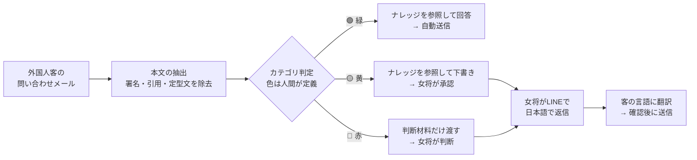

# 旅館向け 多言語問い合わせ自動対応システム

> A multilingual inquiry assistant for small Japanese inns — the owner works only in Japanese on LINE, and AI handles the language barrier behind the scenes.

英語が苦手な小規模旅館の女将さんが、**LINEで日本語だけ**を使って外国人客の問い合わせに対応できるようにするシステムのデモです。言語の壁はすべて裏側でAIが吸収します。

---

## 解決したい課題

岐阜・中山道の馬籠宿のような観光地では、欧米からの個人旅行客が増えています。一方で、そこにある宿の多くは家族経営で、次のような事情を抱えています。

- 女将さんは英語が苦手で、新しいアプリを覚えるのも負担が大きい
- 問い合わせは直接のメールのほか、Booking.com や Agoda からの通知メールでも届く
- 料金や空室のことを間違えて答えると、実際のトラブルにつながる

そこで、**女将さんがすでに使っているLINEだけで、日本語で完結する**ことを前提に設計しました。

## 全体の流れ



## 設計で特に意識したこと

### 1. 難しいかどうかの判断をAIに任せない
問い合わせは「緑（自動送信）／黄（女将が承認）／赤（女将が判断）」の3段階に分けます。ただし、**どのカテゴリを何色にするかは人間が事前に決めておき、AIは問い合わせをカテゴリに当てはめるだけ**にしました（[`data/triage-rules.json`](data/triage-rules.json)）。AIに「これは簡単そうだから自動で返そう」と判断させると、間違えたときに責任を持てないためです。

### 2. ナレッジに書かれていないことは答えない
回答はすべて宿のナレッジ（[`data/knowledge/inn-knowledge.md`](data/knowledge/inn-knowledge.md)）だけを根拠に作ります。書かれていないことを聞かれた場合は、推測で補わずに女将さんへ回します。さらに、緑に分類された問い合わせでもナレッジで答えきれなければ、**黄や赤に格下げして人の確認を挟む**ようにしています。

### 3. 赤ではAIが返信を書かない
車椅子での宿泊や予約変更のような個別の事情は、女将さんが判断するべきものです。そのため赤の問い合わせでは客への返信文を作らず、**判断に必要な事実だけをナレッジから拾って渡す**ようにしました。

### 4. 迷ったら安全な側へ
複数のカテゴリに当てはまる場合は、最も慎重な色を採用します。どのカテゴリにも当てはまらない場合は赤になります。

### 5. OTAの中のメッセージは直接読まない
Booking.com などのメッセージを直接取得するには、公式のパートナー契約が必要です。個人では現実的ではないため、**宿に届く通知メールを唯一の入口**にしました。実際の宿の運用にも近い形です。

## 検証結果

### 実際のメールに近い「汚いメール」6通での比較

最初はキーワードの一致で本文を抽出していましたが、実際の通知メールを想定してテストしたところ、うまく動かないケースが多く見つかりました。そこで抽出部分をClaudeに置き換えています。

| テストしたメール | 置き換え前（キーワード一致） | 置き換え後（Claude） |
|---|---|---|
| Booking.com の通知（定型文が多い） | 定型文ごと抽出し、**日付を誤って作ってしまった** | ✅ 客の質問だけを抽出 |
| Agoda の通知（本文が含まれていない） | 赤に分類されたまま | ✅ 「ログインして確認してください」と案内 |
| 予約確定の通知 | ❌ 料金の問い合わせと**誤判定** | ✅ 問い合わせではないと判定 |
| 署名と過去のやり取りの引用つきメール | ❌ 引用部分の語句を拾って誤分類 | ✅ 本人の質問だけを抽出 |
| Expedia からの宣伝メール | ❌ 宣伝文の語句に反応して**誤判定** | ✅ 問い合わせではないと判定 |
| 複数の言語と質問が混ざったメール | ✅ 正しく赤に分類 | ✅ そのまま正しく分類 |

→ 詳細：[docs/results/extract-test.md](docs/results/extract-test.md)

### ナレッジを参照した回答の例

**料金の計算**：「11月中旬に大人2人と9歳の子ども1人、一番広い部屋でいくらか」という質問に対して、ナレッジの部屋一覧・繁忙期の期間（11/1〜11/23）・料金表・子ども料金（大人の70%）を組み合わせ、**合計56,700円**と正しく答えました。決まった文を返すだけの仕組みでは対応できない質問です。

**ナレッジにない質問**：「小型犬と一緒に泊まれるか」という質問に対しては、ナレッジにペットについての記載がないため**回答を作らず**、女将さんに「ペットの宿泊可否はナレッジに記載がありません」と伝えました。

**曖昧さの指摘**：「20時ごろに着く」という問い合わせでは、チェックインの規定・最終バスの時刻・送迎の時間帯を女将さんに渡したうえで、「20時ちょうどが『20時以降はお断り』に当たるかは記載がない」と、ナレッジの曖昧な点まで指摘しました。

→ 全6件の結果：[docs/results/kb-test.md](docs/results/kb-test.md)

### 端から端までの流れ

受信メール → 本文の抽出 → 分類 → 日本語の要約 → 女将さんの日本語の返信 → 客の言語への翻訳、までを通しで動かしています。翻訳では、女将さんが書いた金額（例：合計72,000円）や条件を変えずに訳せていることを確認しました。

→ 詳細：[docs/results/e2e-test.md](docs/results/e2e-test.md)

## 技術スタック

| 用途 | 使ったもの |
|---|---|
| AI（抽出・分類・回答・翻訳） | Claude API（Anthropic SDK、構造化出力） |
| 本体 | TypeScript / Node.js（ビルドなしで直接実行） |
| ワークフロー | n8n（Docker） |
| 女将さんとのやり取り | LINE Messaging API |
| 外部からの接続 | Cloudflare Tunnel |
| メール送信 | Nodemailer（Gmail SMTP） |

## 動かし方

```bash
npm install
cp .env.example .env   # ANTHROPIC_API_KEY を入れる
npm run kb             # ナレッジを参照した回答のテスト
npm run test:extract   # 汚いメールからの抽出テスト
npm run e2e            # 端から端まで（メール送信はしない）
```

自分で架空の宿を用意して試す場合は、[`data/knowledge/inn-knowledge.md`](data/knowledge/inn-knowledge.md) と [`data/test-inquiries.json`](data/test-inquiries.json) を書き換えてください。LINE（n8n）側の設定手順は [n8n/SETUP.md](n8n/SETUP.md) にまとめています。

## ディレクトリ構成

```
src/
  extract.ts     メールから客の質問だけを抽出（Claude）
  classify.ts    人間が決めたカテゴリへの当てはめ（Claude）
  answer.ts      ナレッジを参照した回答・赤の判断材料の作成（Claude）
  translate.ts   女将さんの日本語を客の言語に翻訳（Claude）
  run-kb-test.ts 格下げの判定を含むテストの実行
data/
  knowledge/inn-knowledge.md  宿のナレッジ（AIが参照する唯一の情報源）
  triage-rules.json           カテゴリと色の対応（人間が定義）
n8n/             LINEとの双方向デモのワークフロー
docs/results/    検証結果
_spec/           最初に書いた設計書
```

## 現時点の制約

- **LINEとの接続部分はまだ翻訳がモックです。** Claudeを使ったナレッジ参照と翻訳はTypeScript側で動いていますが、LINE（n8n）側にはまだつないでいません。そのため、LINE上では登録済みの例文しか翻訳できません。
- **メールの受信は自動化していません。** 現在はテスト用のメールを読み込んで動かしています。
- **OTA経由の客にはメールで返信できません。** OTAは客の本当のメールアドレスを隠すため、返信は各OTAの管理画面から行う必要があります。この場合は、翻訳した文を女将さんに渡して貼り付けてもらう形を想定しています。
- 宿・問い合わせ・料金はすべて**架空のデータ**です。

## 今後の予定

1. ナレッジ参照と翻訳をLINE側につなぎ、LINE上で自由な日本語でやり取りできるようにする
2. IMAPで実際に届いたメールから処理を始められるようにする
3. 実在の宿に協力してもらい、トリアージ表とナレッジが実際の問い合わせに合っているかを検証する

---

開発の経緯や細かい手順は [docs/DEVELOPMENT.md](docs/DEVELOPMENT.md) にあります。
